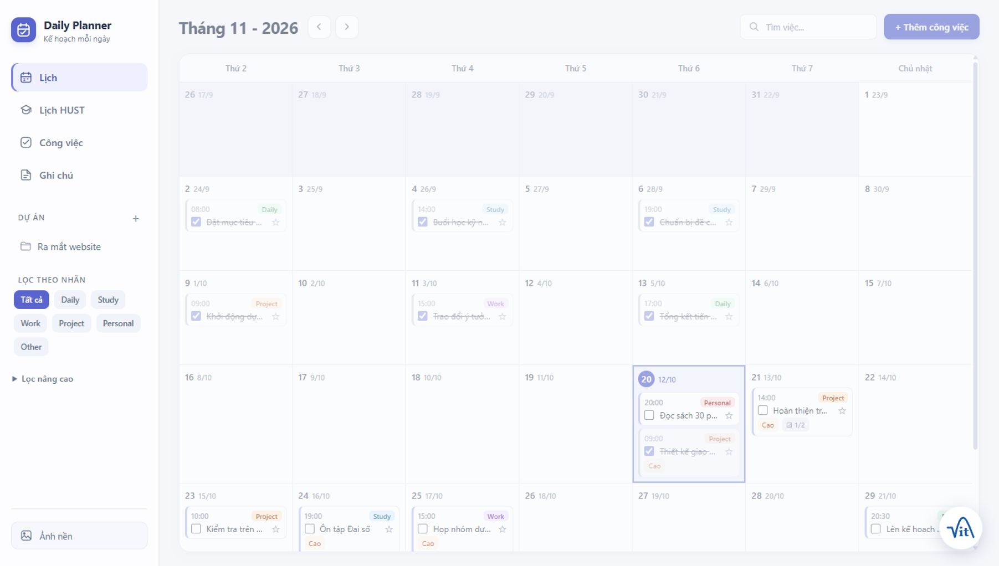
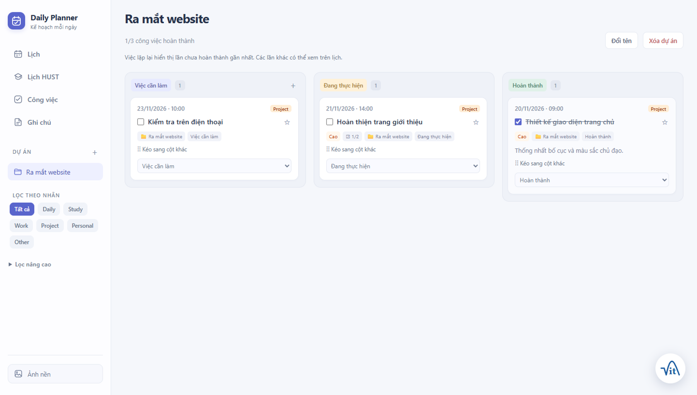
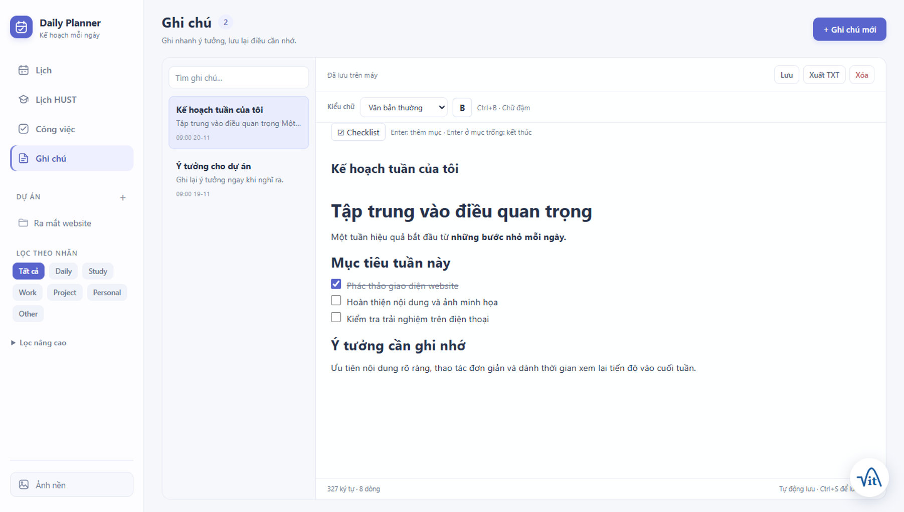

<div align="center">

# Daily Planner

**Lịch trình, công việc và ý tưởng — trong một không gian của riêng bạn.**

Ứng dụng lập kế hoạch cá nhân cho Windows và trình duyệt.<br />
Lưu dữ liệu trên thiết bị · Không cần tài khoản · Chatbot hoạt động offline

[](https://github.com/NgDucNguyen/ToDoList/actions/workflows/ci.yml)
[](package.json)
[](app.js)
[](package.json)
[](LICENSE)

[Bắt đầu](#bắt-đầu) · [Tính năng](#tính-năng) · [Hướng dẫn](docs/USER_GUIDE.md) · [Bản phát hành](https://github.com/NgDucNguyen/ToDoList/releases) · [Báo lỗi](https://github.com/NgDucNguyen/ToDoList/issues)



<sub>Giao diện thật với dữ liệu minh họa. Mỗi người dùng có dữ liệu riêng trên thiết bị của mình.</sub>

</div>

## Tổng quan

Daily Planner dành cho việc tự quản lý lịch học, công việc và ghi chú hằng ngày. Bạn có thể bắt đầu bằng một công việc trên lịch, theo dõi tiến độ trong Kanban và lưu những điều cần nhớ ngay trong app.

Ứng dụng sử dụng HTML, CSS và JavaScript thuần, đóng gói desktop bằng Electron. **Không cần thiết lập backend hoặc database server để sử dụng cá nhân.** Dữ liệu hiện lưu cục bộ; các bản web, desktop và thiết bị khác nhau chưa tự đồng bộ với nhau.

## Tính năng

| | Bạn có thể làm gì? |
| --- | --- |
| **Lịch cá nhân** | Xem lịch tháng và âm lịch Việt Nam; lên lịch theo ngày, giờ; tìm kiếm và lọc nhãn. |
| **Công việc & Kanban** | Quản lý dự án, kéo thả giữa ba trạng thái, đặt ưu tiên, gắn sao và thêm checklist. |
| **Lịch lặp & nhắc việc** | Lặp theo ngày/tuần/tháng, chỉnh một lần hoặc cả chuỗi; lưu mẫu và đặt lời nhắc. |
| **Ghi chú có định dạng** | Tự lưu, tô đậm bằng Ctrl+B, tiêu đề 1/2/3, checklist có ô tích, tìm kiếm và xuất TXT. |
| **Trợ lý tiếng Việt** | Tra cứu/tóm tắt lịch, tìm ghi chú và đề xuất tạo mới; chỉ lưu sau khi bạn xác nhận. |
| **Lịch học HUST** | Trang lịch học riêng, thêm buổi thủ công; desktop hỗ trợ nhập thời khóa biểu QLĐT. |
| **Không gian cá nhân** | Tải ảnh nền, chỉnh độ phủ sáng và làm mờ; giao diện điều chỉnh theo cửa sổ. |

<details>
<summary><strong>Xem thêm giao diện Kanban và Ghi chú</strong></summary>

### Theo dõi tiến độ dự án



### Ghi lại ý tưởng và từng bước cần làm



</details>

## Bắt đầu

### Chạy từ mã nguồn

**Yêu cầu:** Node.js ≥ 22.12, npm và Git. Desktop/build được kiểm tra trên Windows x64.

```sh
git clone https://github.com/NgDucNguyen/ToDoList.git
cd ToDoList
npm ci
npm start
```

Lần cài đầu cần Internet để tải thư viện và Electron. Nếu PowerShell chặn `npm.ps1`, dùng `npm.cmd` thay cho `npm`.

### Dùng bản Windows

Tải ZIP Windows x64 trong [Releases](https://github.com/NgDucNguyen/ToDoList/releases), giải nén **toàn bộ** rồi chạy `MyDailyPlanner.exe`. Giữ nguyên các tệp đi kèm; có thể tạo shortcut ra Desktop.

Nếu chưa có ZIP trong Releases, bạn có thể chạy từ mã nguồn hoặc tự đóng gói bằng `npm run build-exe`. Bản hiện tại là portable, chưa có bộ cài hoặc chữ ký phát hành.

### Dùng trên trình duyệt

Mở `index.html` để thử nhanh, hoặc xuất thư mục web để phục vụ bằng máy chủ tĩnh:

```sh
npm run build:web
```

Terminal in đường dẫn `dist/web-<mã>/`. Xem [hướng dẫn triển khai GitHub Pages](docs/DEVELOPMENT.md#bật-github-pages) để chia sẻ bản web.

## Desktop và web

| Khả năng | Windows | Web |
| --- | :---: | :---: |
| Lịch, công việc, Kanban, ghi chú và ảnh nền | ✓ | ✓ |
| Chatbot nội bộ, không cần API key | ✓ | ✓ |
| Thêm buổi học thủ công | ✓ | ✓ |
| Đăng nhập và nhập thời khóa biểu HUST | ✓ | — |
| Nhắc việc khi app/trang đang mở | ✓ | ✓ |
| Đồng bộ dữ liệu giữa thiết bị | — | — |

Thông báo hệ thống phụ thuộc quyền và cấu hình thiết bị. Các chức năng lập kế hoạch và chatbot không cần mạng; kết nối QLĐT HUST cần Internet.

## Dữ liệu thuộc về bạn

- **Windows:** hồ sơ mặc định tại `%APPDATA%\todolist`, tách khỏi thư mục EXE. Mỗi người dùng app lưu dữ liệu trong hồ sơ trên máy của mình.
- **Web:** lưu bằng localStorage và IndexedDB, riêng theo trình duyệt và địa chỉ website. Xóa dữ liệu trang có thể làm mất lịch và ghi chú.
- **Sao lưu:** đóng Planner cùng cửa sổ HUST rồi copy toàn bộ `%APPDATA%\todolist` ra nơi riêng trước khi cập nhật. Hồ sơ có thể chứa phiên đăng nhập; không tải lên GitHub.

Build lại EXE thường giữ dữ liệu khi giữ nguyên hồ sơ ứng dụng. Bản dự phòng nội bộ và chức năng xuất TXT không thay thế sao lưu đầy đủ. Xem [sao lưu, cập nhật và khôi phục](docs/USER_GUIDE.md#dữ-liệu-sao-lưu-và-cập-nhật).

## Phát triển

| Lệnh | Chức năng |
| --- | --- |
| `npm start` | Chạy bản desktop từ mã nguồn. |
| `npm test` | Kiểm tra dữ liệu, lịch lặp, ghi chú, HUST, chatbot và file phát hành. |
| `npm run test:ui` | Kiểm tra các luồng sử dụng và kích thước cửa sổ. |
| `npm run test:electron` | Kiểm tra bản desktop trong hồ sơ tạm. |
| `npm run test:hust` | Kiểm tra kết nối HUST với trang giả lập. |
| `npm run build:web` | Xuất bản web tĩnh. |
| `npm run build-exe` | Đóng gói Windows x64 vào thư mục mới dưới `dist/`. |
| `npm run train:chatbot` | Huấn luyện lại bộ nhận diện ý định từ câu mẫu của dự án. |

Các bài kiểm tra giao diện dùng dữ liệu mẫu và hồ sơ tạm, tách khỏi dữ liệu cá nhân. Workflow GitHub hỗ trợ kiểm tra mã, build Windows và triển khai Pages theo yêu cầu.

→ [Cấu trúc mã nguồn, kiểm tra và phát hành](docs/DEVELOPMENT.md)

## Phạm vi hiện tại

- **Cá nhân, lưu cục bộ:** chưa có đăng nhập, cộng tác, đồng bộ đám mây hoặc sao lưu toàn bộ dữ liệu web qua giao diện.
- **Chatbot chuyên cho Planner:** dùng bộ phân loại ý định và xử lý ngày giờ, không phải mô hình ngôn ngữ lớn. Hiện đề xuất tạo một việc/ghi chú mỗi lần; chưa sửa/xóa qua hội thoại.
- **HUST là tích hợp tùy chọn:** chỉ nhập thời khóa biểu gốc; nghỉ, đổi lịch và học bù cần chỉnh thủ công. Bộ đọc có thể cần cập nhật khi cổng QLĐT thay đổi. Dự án không phải sản phẩm chính thức của HUST.
- **Nền tảng đã kiểm tra:** Windows x64 và giao diện web; chưa kiểm chứng bản đóng gói macOS/Linux. App cần mở để nhắc việc hoặc tự cập nhật HUST.

## Tài liệu

- [Hướng dẫn sử dụng](docs/USER_GUIDE.md) — công việc, ghi chú, chatbot, HUST và sao lưu.
- [Phát triển và phát hành](docs/DEVELOPMENT.md) — cấu trúc dự án, kiểm tra, build, GitHub Pages và xử lý lỗi.

## Đóng góp

Bạn có thể [báo lỗi hoặc đề xuất tính năng](https://github.com/NgDucNguyen/ToDoList/issues), hoặc gửi pull request. Khi báo lỗi, ghi rõ phiên bản, hệ điều hành và các bước tái hiện; không gửi mật khẩu, cookie hoặc dữ liệu cá nhân.

Trước khi gửi thay đổi, chạy các kiểm tra liên quan. Thay đổi cách lưu dữ liệu cần bảo toàn dữ liệu cũ và có phương án chuyển đổi/sao lưu.

## Giấy phép

Phát hành theo [ISC License](LICENSE). Electron và các thư viện đi kèm giữ giấy phép riêng.
